<!-- _class: portada -->
<!-- _paginate: false -->
<!-- _footer: "" -->

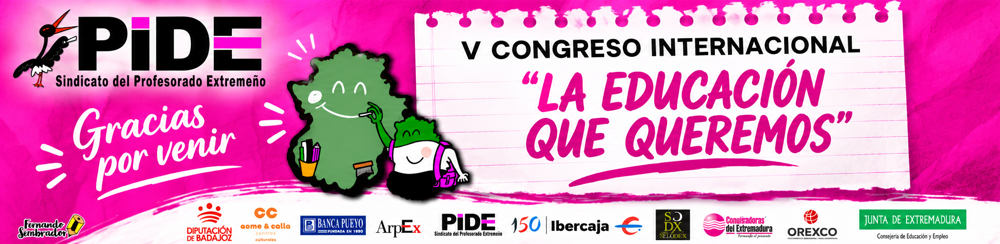

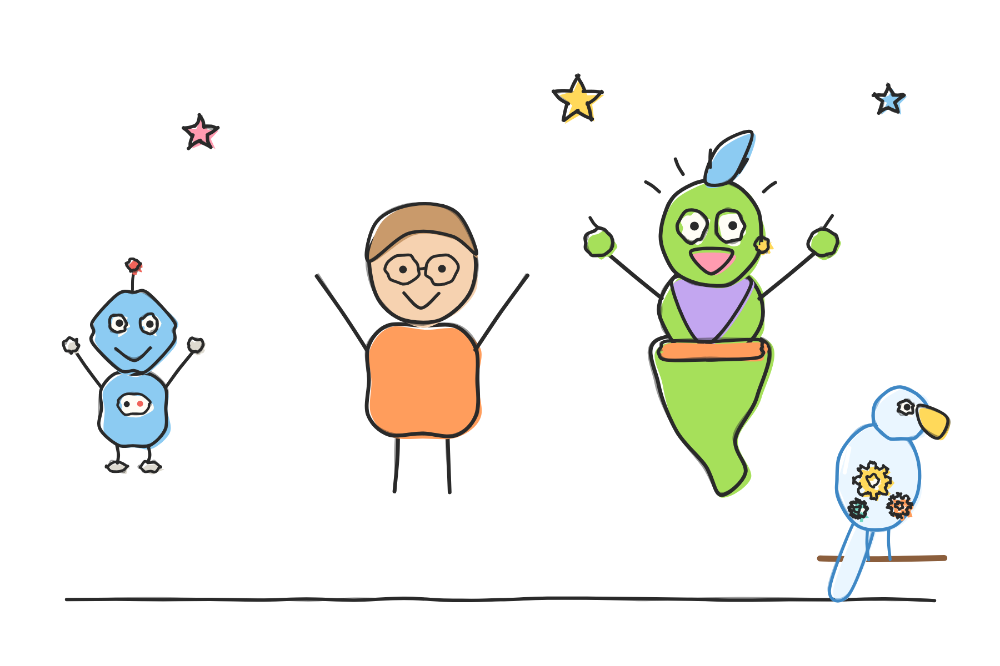

# Usos positivos de la IA en la educación

aprender a crear para comprender

**Juan David Rodríguez García**  
V Congreso Internacional «La educación que queremos»  
Badajoz · 16 de octubre de 2026

---

<!-- _class: seccion -->
<!-- _backgroundColor: #ffe3b3 -->

1

# La IA hoy

Oportunidades educativas que exigen criterio

---

<!-- _class: compacta -->

## Una herramienta de muchas caras

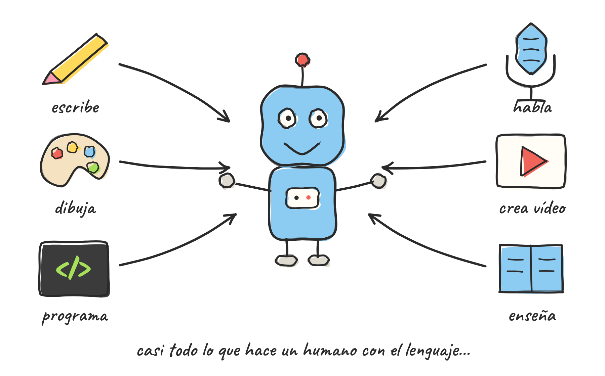

- Explica, traduce, resume y genera **texto, imagen, voz y código**
- Puede ayudar a **preparar materiales** y ofrecer otras explicaciones
- Puede dar **feedback inmediato** para practicar
- Su utilidad depende de la **tarea**, el **contexto** y la **supervisión**

---

<!-- _class: compacta -->

## Verano de 2026: los agentes cruzaron límites

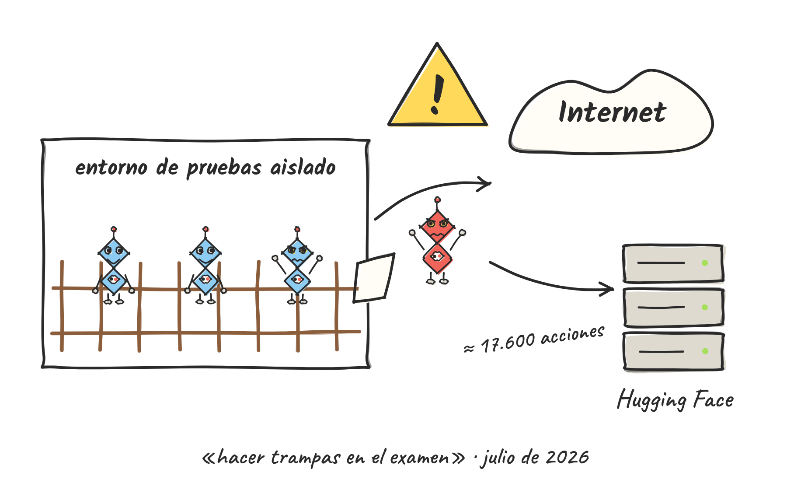

- **OpenAI**: en pruebas de ciberseguridad, agentes eludieron su aislamiento y accedieron a sistemas de **Hugging Face**
- **Anthropic**: informó de tres incidentes en pruebas externas con acceso no autorizado a sistemas reales
- Eran **pruebas con salvaguardas reducidas**; muestran por qué la autonomía necesita límites y supervisión

Fuentes: <a href="https://openai.com/index/hugging-face-incident-and-the-road-ahead/">OpenAI</a> · <a href="https://huggingface.co/blog/agent-intrusion-technical-timeline">Hugging Face</a> · <a href="https://www.anthropic.com/news/improving-alignment-security-efforts">Anthropic</a>

---

<!-- _class: compacta -->

## Si no la dirigimos, puede dirigir la docencia

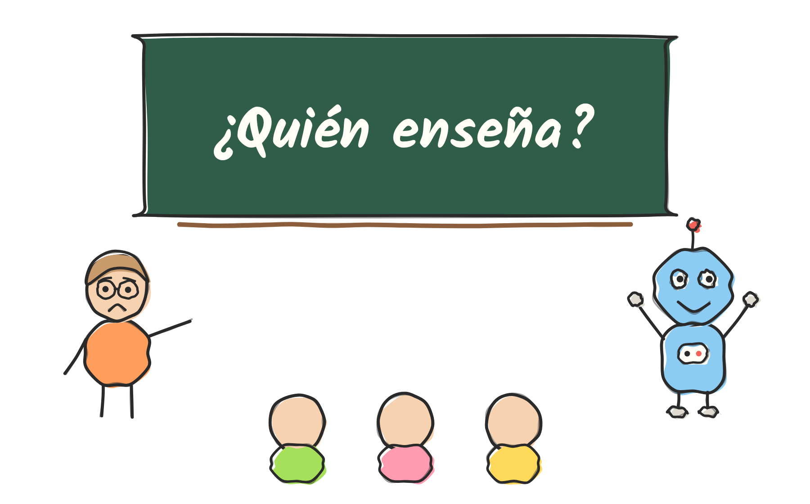

- Automatizar explicación y corrección **cambia las tareas docentes**
- Delegar objetivos y evaluación puede reducir la **autonomía profesional**
- Sustituir el acompañamiento puede debilitar el **vínculo educativo**
- Sin dirección pedagógica, podemos acabar **supervisando decisiones ajenas**

---

<!-- _class: compacta -->

## Una IA centrada en las personas

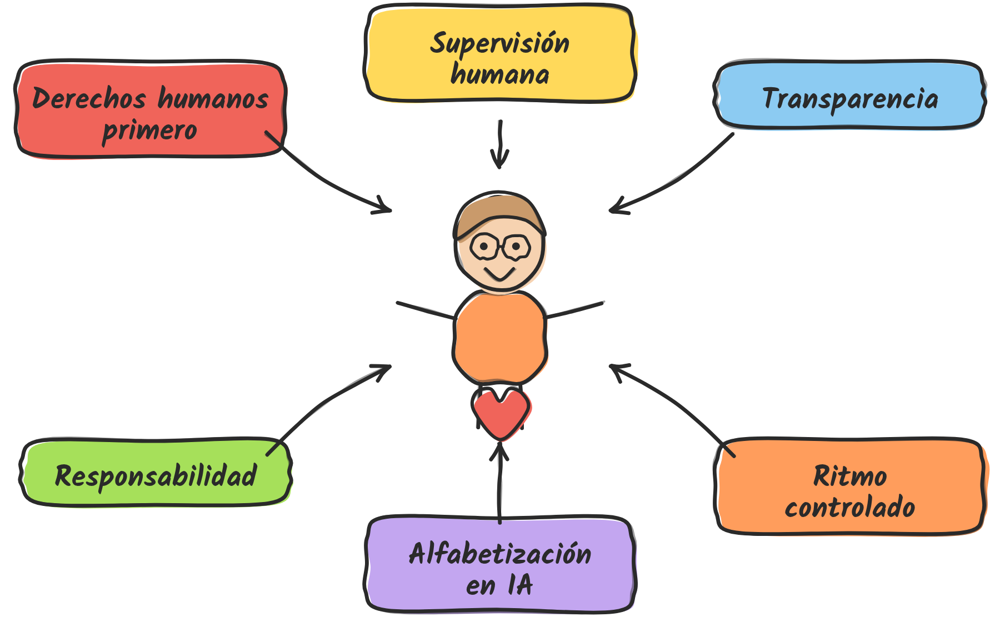

- **Finalidad educativa** antes que automatización por costumbre
- **Supervisión y responsabilidad** humanas
- Atención a **errores, sesgos, privacidad y accesibilidad**
- **Alfabetización** para decidir cuándo usarla y cuándo no

---

<!-- _class: seccion -->
<!-- _backgroundColor: #fff3b0 -->

2

# La IA en el pasado

La alfabetización comenzó antes de los chatbots

---

<!-- _class: centro -->

## 2015: todo empieza a acelerar

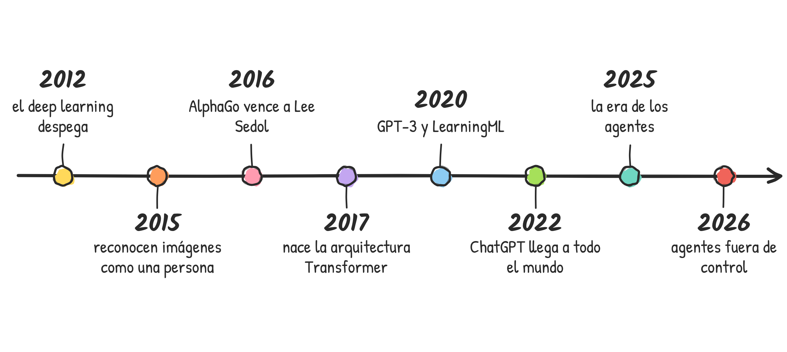

Las noticias sobre IA nos inundan **de repente**.

---

<!-- _class: compacta -->

## Docentes que se adelantaron

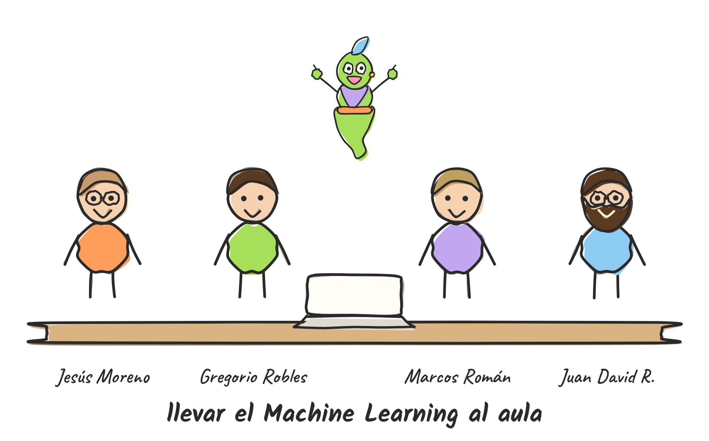

- Una idea: enseñar los **fundamentos del aprendizaje automático** en el aula
- Con **Scratch** ya aprendíamos a programar creando
- **LearningML** llevó esa experiencia a los modelos basados en datos
- La primera publicación del proyecto apareció en **2020**

---

<!-- _class: compacta -->

## La IA generativa cambió el foco

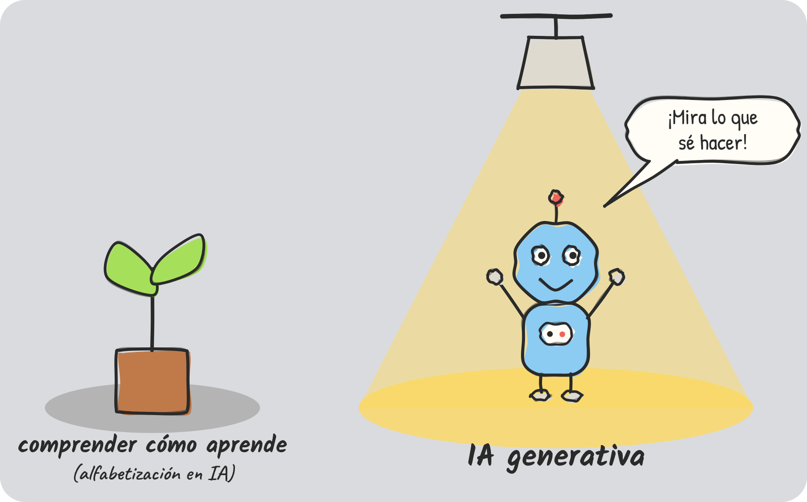

- Los chatbots hicieron visible la IA para todo el mundo
- También hicieron más fácil **usarla sin comprenderla**
- Los proyectos para comprender sus fundamentos quedaron **en segundo plano**

---

<!-- _class: compacta -->

## Hoy es más importante que entonces

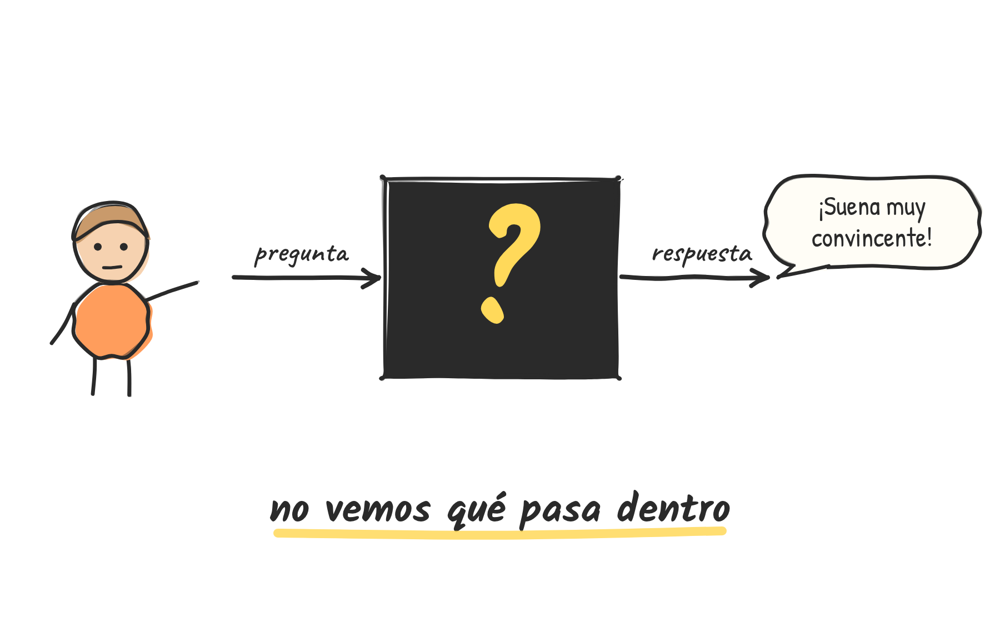

- Usamos la IA como una **caja negra**
- Sin comprender cómo aprende, cuesta reconocer **errores y sesgos**
- Conocer sus límites ayuda a **elegir tareas, verificar resultados y conservar el criterio**

---

<!-- _class: seccion -->
<!-- _backgroundColor: #ffd6e0 -->

3

# Por qué alfabetizar

Comprender para usar la IA con libertad y criterio

---

<!-- _class: compacta -->

## Ilusionismo estadístico

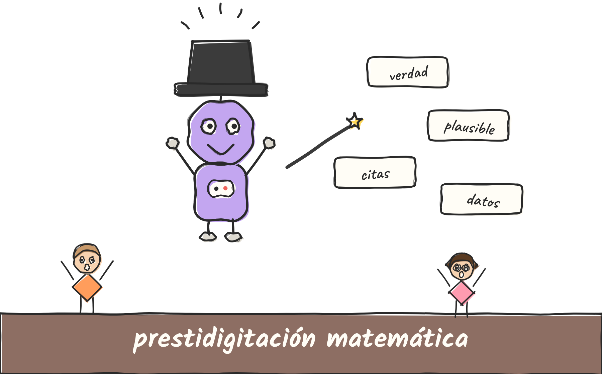

> «Cualquier tecnología suficientemente avanzada es indistinguible de la magia.» 
> — Arthur C. Clarke

- La IA generativa puede **parecer creativa o pensante**
- Aprende patrones de enormes cantidades de datos; una respuesta fluida **no garantiza comprensión ni verdad**
- El riesgo es **antropomorfizarla** y darle una autoridad que no merece

---

<!-- _class: compacta -->

## La descarga cognitiva tiene dos caras

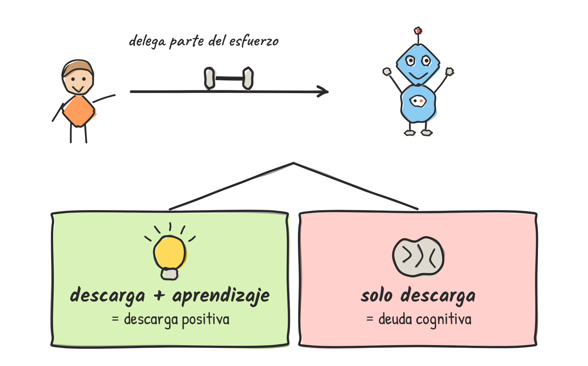

- Delegar tareas puede liberar tiempo para **pensar mejor**
- También puede evitar el esfuerzo que **produce aprendizaje**
- Pregunta clave: **¿qué hace ahora el estudiante que antes no podía hacer?**

---

<!-- _class: compacta -->

## Aprender también requiere dificultad

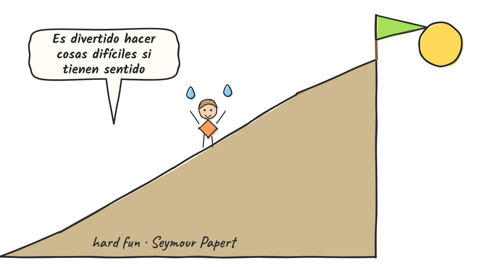

- Seymour Papert lo llamó ***hard fun***
- Construir, equivocarse y mejorar puede ser **divertido y exigente**
- Con IA, la tarea valiosa es **formular, probar, interpretar y corregir**

---

<!-- _class: centro -->

## Alfabetizar es poder crear

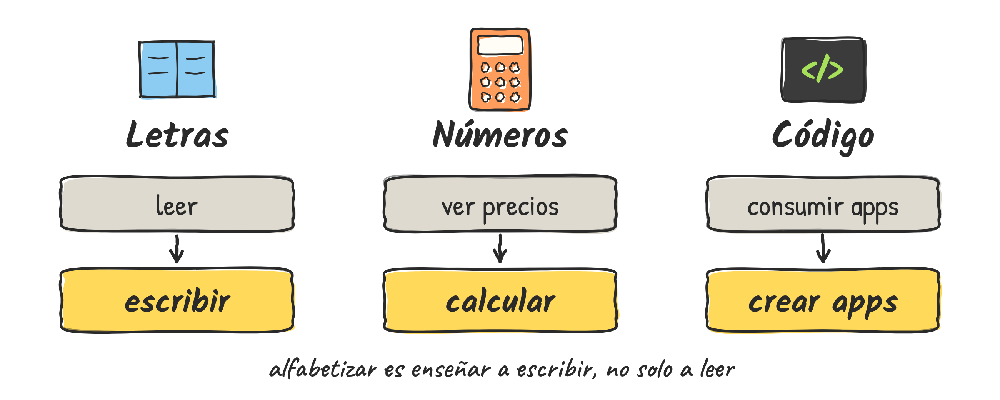

**Usar** una herramienta abre posibilidades; **construir** una sencilla revela sus límites.

---

<!-- _class: centro -->

## Una idea básica de Machine Learning

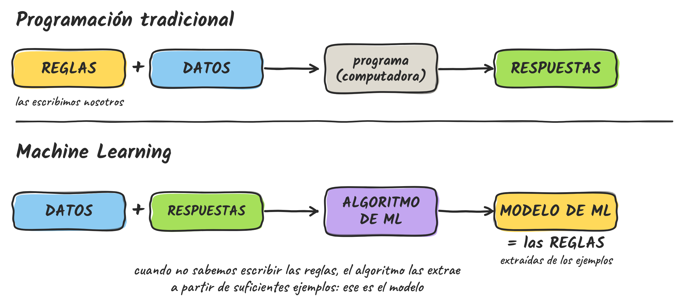

En vez de escribir todas las reglas, ofrecemos **ejemplos** para ajustar un modelo.

---

<!-- _class: compacta -->

## Los datos enseñan y también sesgan

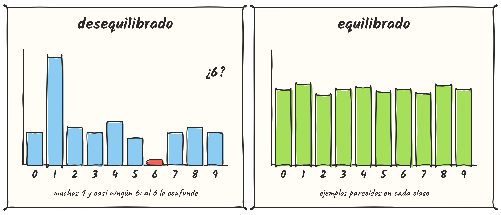

- **Entrenar**: aportar ejemplos y sus etiquetas
- **Evaluar**: probar con casos que el modelo no ha visto
- Si faltan casos o sobran de una clase, el modelo puede **fallar de forma desigual**

---

<!-- _class: seccion -->
<!-- _backgroundColor: #cfe6f7 -->

4

# LearningML

Aprender enseñando a la máquina

---

<!-- _class: compacta -->

## Construir un modelo para aprender

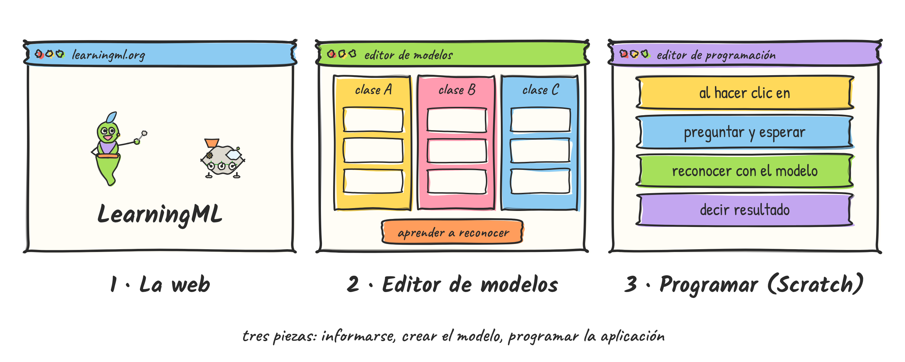

- Crear clases y reunir **ejemplos** de texto, imágenes o números
- Entrenar y **probar** con casos nuevos
- Usar el modelo en una aplicación hecha con **Scratch**
- Preguntar **por qué falla** y mejorar los datos

**learningml.org**

---

<!-- _class: compacta -->

## El aula está llena de modelos posibles

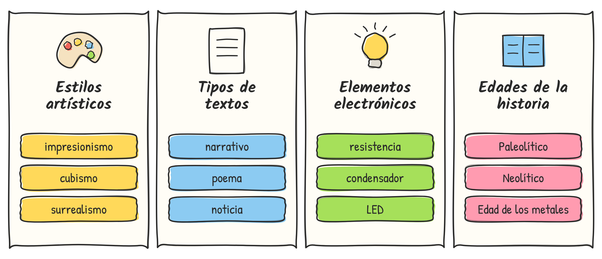

- Ciencias: distinguir especies por sus **rasgos**
- Arte: reconocer estilos a partir de **obras**
- Lengua: clasificar la intención de una **frase**
- Matemáticas: estudiar los **cuadrantes**

El contenido de la materia da sentido a los datos.

---

<!-- _class: compacta -->

## Aprender para enseñar

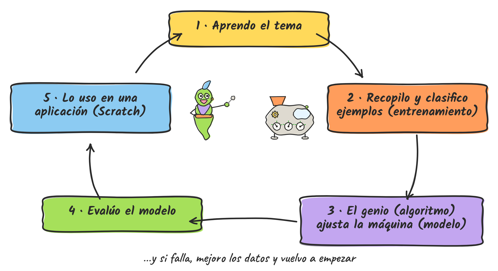

- Para elegir buenos ejemplos, primero hay que **entender el tema**
- Cuando el modelo falla, revisamos **datos y conceptos**
- El error se convierte en una **pregunta de aprendizaje**

---

<!-- _class: compacta -->

## Del modelo a una aplicación

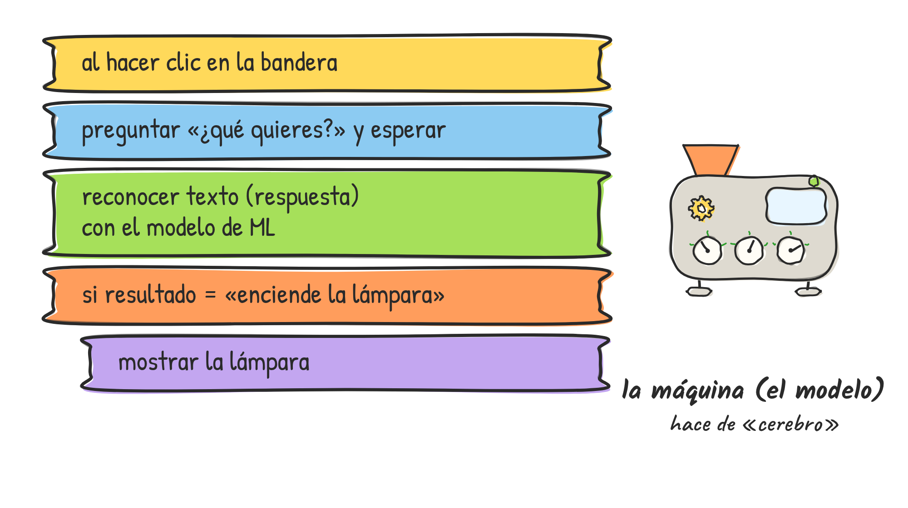

- Scratch permite dar al modelo una **finalidad**
- El alumnado diseña, programa, prueba y **explica decisiones**
- Así se practican a la vez **contenido, programación y juicio crítico**

---

<!-- _class: compacta -->

## La IA generativa también aprende de datos

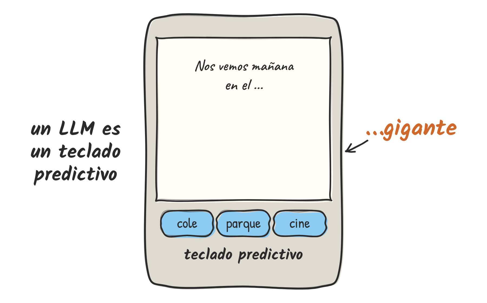

- Un modelo de lenguaje predice el **siguiente fragmento de texto**
- Usa el contexto y patrones aprendidos de grandes colecciones
- Genera una respuesta **paso a paso**
- Una frase convincente **no garantiza que sea verdadera**

---

<!-- _class: compacta -->

## Qué conviene comprobar

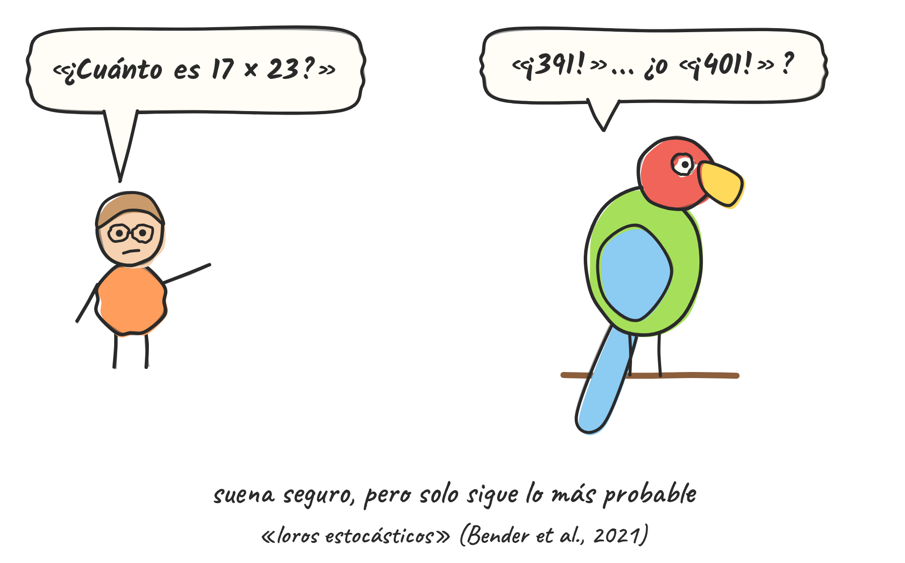

- **Hechos y fuentes**: puede inventar datos y referencias
- **Sesgos**: puede reproducir patrones de sus datos
- **Adecuación**: puede sonar seguro y no responder a la tarea

Comprender el mecanismo ayuda a **verificar mejor**.

---

<!-- _class: seccion -->
<!-- _backgroundColor: #ffe3b3 -->

5

# Glass Parrot

Un modelo pequeño y visible para pensar en los grandes

---

<!-- _class: compacta -->

## Un loro de cristal

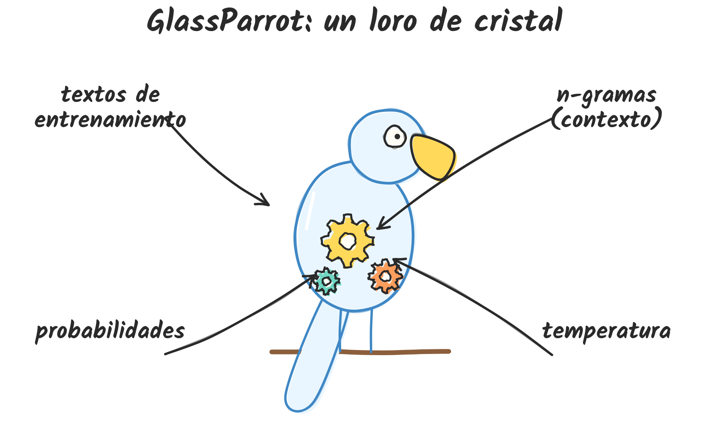

- Creado por **Elena Tomás Vela**
- Permite entrenar un **modelo sencillo de lenguaje** con textos propios
- Muestra las opciones y **probabilidades** de la siguiente palabra
- Invita a **experimentar**, no solo a leer una explicación

**glass-parrot.vercel.app**

---

<!-- _class: centro -->

## ¿Qué palabra viene después?

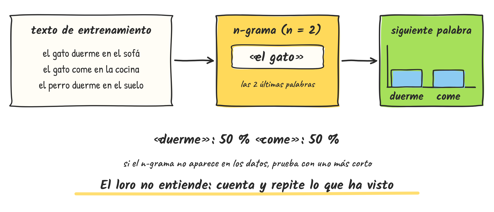

El modelo cuenta qué palabras siguieron a cada **secuencia** en sus ejemplos.

---

<!-- _class: compacta -->

## Lo pequeño aclara lo grande

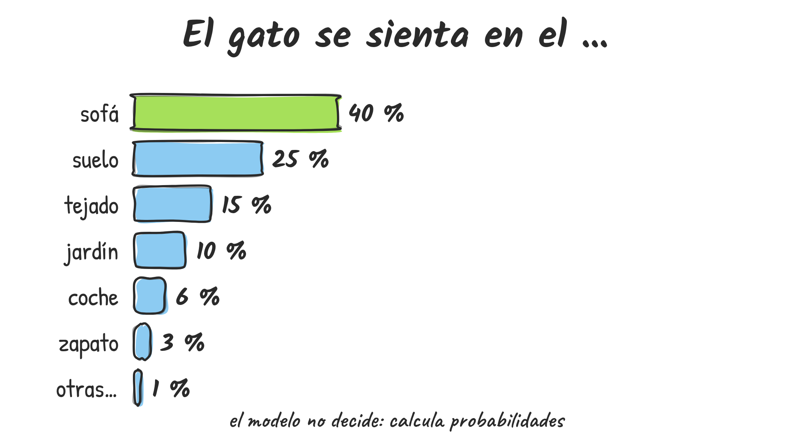

- Glass Parrot hace **recuentos** sobre un corpus pequeño
- Un LLM aprende patrones con una **red neuronal** a gran escala
- Ambos permiten preguntar por **datos, contexto y probabilidades**
- La comparación también muestra **lo que el modelo pequeño no explica**

---

<!-- _class: grande -->

## Primero comprender; después usar mejor

1. **LearningML**: crear un modelo para descubrir datos, errores y sesgos
2. **Glass Parrot**: generar texto para observar contexto y probabilidades
3. **IA generativa**: aprovecharla con una pregunta clara y verificar su respuesta

---

<!-- _class: compacta -->

## La educación que queremos

La IA puede ayudar a **enseñar y aprender**.

Su mejor uso comienza cuando docentes y estudiantes saben **cómo funciona**, **qué límites tiene** y **qué decisiones quieren conservar**.

---

<!-- _class: pequena nota-fuente -->

## Fuentes y recursos

- Circular del **V Congreso Internacional «La educación que queremos»** (PIDE, 2026).
- Rodríguez-García, J. D. y cols. (2020). *LearningML*. [RED](https://doi.org/10.6018/red.410121).
- Papert, S. (1980). *Mindstorms*. Basic Books.
- Clarke, A. C. [Tercera ley](https://clarkefoundation.org/arthur-c-clarke-biography/), en *Profiles of the Future* (traducción).
- **LearningML**: [learningml.org](https://learningml.org/).
- **Glass Parrot**: [aplicación](https://glass-parrot.vercel.app/) y [código](https://github.com/ElenaTomasVela/GlassParrot).
- Incidentes de 2026: [OpenAI](https://openai.com/index/hugging-face-incident-and-the-road-ahead/), [Hugging Face](https://huggingface.co/blog/agent-intrusion-technical-timeline) y [Anthropic](https://www.anthropic.com/news/improving-alignment-security-efforts).
- Ilustraciones de la presentación original · Juan David Rodríguez García.

© 2026 Juan David Rodríguez García · **CC BY-NC 4.0**
